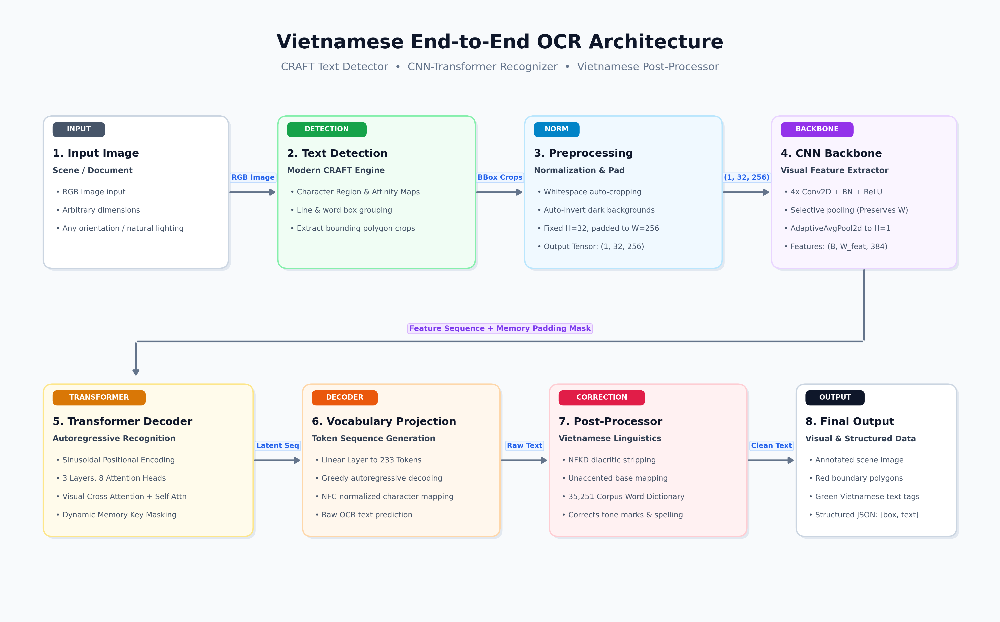

# Vietnamese End-to-End OCR: CRAFT Detector + Transformer Recognizer

[](https://pytorch.org/)
[](https://www.python.org/)
[]()
[]()
[]()

A high-accuracy, lightweight end-to-end Optical Character Recognition (OCR) pipeline specifically designed for **Vietnamese text** in natural scene images and documents. The system seamlessly combines **CRAFT (Character-Region Awareness for Text Detection)**, a tailored **CNN + Transformer Decoder** recognition model, and an algorithmic **Vietnamese Post-Processor** for diacritic and spelling correction.

---

## 📌 Table of Contents

- [Overview](#-overview)
- [System Architecture](#-system-architecture)
- [Key Features](#-key-features)
- [Model Specifications](#-model-specifications)
- [Repository Structure](#-repository-structure)
- [Installation & Requirements](#-installation--requirements)
- [Quick Start & Usage](#-quick-start--usage)
  - [1. Inference on Scene Images (End-to-End Pipeline)](#1-inference-on-scene-images-end-to-end-pipeline)
  - [2. Single Text-Line Recognition](#2-single-text-line-recognition)
  - [3. Running the Jupyter Notebook](#3-running-the-jupyter-notebook)
- [Dataset & Training](#-dataset--training)
- [Performance & Results](#-performance--results)
- [Vietnamese Post-Processor](#-vietnamese-post-processor)
- [License](#-license)

---

## 🚀 Overview

Vietnamese text recognition presents unique challenges due to extensive diacritic marks (tone marks: acute, grave, hook above, tilde, dot below; and vowel modifications: circumflex, breve, horn). Small inaccuracies in feature extraction often cause incorrect tone placement.

This project solves this by:
1. **Accurate Text Localization**: Detecting text bounding polygons via a modernized CRAFT detector engine.
2. **Context-Aware Sequence Modeling**: Replacing traditional CTC/LSTM models with a **CNN Backbone + PyTorch Transformer Decoder** with cross-attention and memory padding masks.
3. **Vietnamese Linguistic Post-Processing**: Automatically verifying and restoring missing/misplaced tone marks and fixing spelling errors using corpus statistics learned from 35,000+ vocabulary words.

---

## 🏗️ System Architecture

<p align="center">
  
</p>

### End-to-End Pipeline Breakdown

1. **Input Scene Image**: Accepts standard RGB images (arbitrary resolutions, scene photographs, scanned documents, receipts, etc.).
2. **Text Detection (Modern CRAFT)**: Character Region Awareness for Text Detection (powered by EasyOCR's CRAFT detector) detects text areas, builds affinity connections, and segments word/line bounding polygons.
3. **Preprocessing & Normalization**:
   - `auto_crop_whitespace`: Automatically clips superfluous white borders around text strokes.
   - `preprocess_auto_invert`: Converts to grayscale and automatically inverts dark-background images for uniform white-background representation.
   - `resize_with_padding`: Scales while strictly preserving original aspect ratio, fixes height to $H=32$, left-aligns text, and pads remainder to $W=256$.
4. **CNN Feature Extractor**: 4 convolutional blocks ($3\times3$ Conv + BatchNorm + ReLU) with asymmetric MaxPool ($2\times2$ in early layers, $(2, 1)$ in later layers to retain horizontal resolution), ending with `AdaptiveAvgPool2d((1, None))` producing a feature sequence of dimension $(B, W_{feat}, d_{model}=384)$.
5. **Transformer Decoder**:
   - Sinusoidal Positional Encoding applied to feature sequences.
   - 3 PyTorch native decoder layers ($d_{model}=384$, 8 heads, $d_{ff}=1024$, dropout $0.3$) utilizing causal self-attention and cross-attention over CNN visual features.
   - Dynamic memory padding mask (`create_memory_mask`) preventing attention to right-side padded zones while preserving inter-character spaces.
6. **Vocabulary Projection & Autoregressive Decoding**: Linear projection layer mapping latent states to 233 character tokens (NFC-normalized Vietnamese vowels/consonants, numbers, punctuation, special tokens `<sos>`, `<eos>`, `<pad>`, `<unk>`).
7. **Vietnamese Post-Processor**: Decomposes text to base form using Unicode NFKD (`remove_accents`), indexes known vocabulary, and restores correct diacritics and spelling against a 35,251-word corpus.
8. **Final Output**: Annotated visual image rendered with red bounding polygons, high-contrast Vietnamese text labels, and structured JSON output `[{"box": [...], "text": "..."}]`.

---

## ✨ Key Features

- **Lightweight & Fast**: Only **~7.35M parameters**, enabling fast inference on GPU and feasible CPU execution.
- **Robust Preprocessing**:
  - `auto_crop_whitespace`: Automatically clips unnecessary padding around text lines while protecting tone marks.
  - `preprocess_auto_invert`: Inverts light-text-on-dark-background images to ensure consistent contrast.
  - `resize_with_padding`: Preserves native aspect ratio, fixes height to 32px, left-aligns text, and pads the remainder to 256px.
- **PyTorch Native Decoder**: Built with `nn.TransformerDecoderLayer(..., batch_first=True)` for optimized memory usage and execution speed.
- **Dynamic Memory Masking**: Custom `create_memory_mask` computes padding masks directly from the original image width to preserve inter-word spaces without attending to right-side padding.
- **Batch Inference**: Grouped cropping and single-pass batch inference for dramatic speedups in complex scene images.
- **Integrated Post-Processor**: Self-learning dictionary-based correction for Vietnamese tone marks.

---

## 🔬 Model Specifications

| Parameter / Component | Specification |
| :--- | :--- |
| **Model Name** | `OCRTransformer` |
| **Total Trainable Params** | **7,354,217 (~7.35M)** |
| **Input Image Dimensions** | `(Channels=1, Height=32, Width=256)` (Grayscale) |
| **CNN Backbone** | 4 Conv2D blocks (`Conv3x3` -> `BN` -> `ReLU`), strategic pooling, `AdaptiveAvgPool2d((1, None))` |
| **Feature Dimension ($d_{model}$)** | `384` |
| **Attention Heads ($n_{head}$)** | `8` |
| **Decoder Layers** | `3` |
| **Feedforward Dimension** | `1024` |
| **Dropout** | `0.3` |
| **Max Sequence Length** | `100` characters |
| **Vocabulary Size** | `233` tokens (NFC-normalized Vietnamese vowels/consonants + digits + punctuation + `<pad>`, `<sos>`, `<eos>`, `<unk>`) |
| **Optimizer** | `AdamW` ($\text{lr}=5\times 10^{-4}$, $\beta_1=0.9, \beta_2=0.98$, $\text{weight\_decay}=0.01$) |
| **Loss Function** | `CrossEntropyLoss` (ignore index `0`, label smoothing `0.1`) |
| **Learning Rate Scheduler** | `ReduceLROnPlateau(factor=0.5, patience=2)` |

---

## 📂 Repository Structure

```
├── OCR.ipynb               # Full end-to-end training and inference notebook
├── best_ocr_model.pth      # Pretrained weights of OCRTransformer (95.06% Val Acc)
├── archive.zip             # Compressed raw dataset archive
├── dataset/                # Dataset directory
│   └── rec/
│       ├── rec_gt_train.txt # Ground truth annotations (100,000 text samples)
│       └── train/          # Image files for recognition training
└── README.md               # Project documentation
```

---

## 📦 Installation & Requirements

Ensure you have Python 3.8+ and PyTorch installed.

```bash
# Clone the repository
git clone https://github.com/your-username/Vietnamese-OCR-Transformer.git
cd Vietnamese-OCR-Transformer

# Install required dependencies
pip install torch torchvision --index-url https://download.pytorch.org/whl/cu118  # Choose your CUDA version
pip install easyocr pillow numpy matplotlib seaborn
```

> **Note**: For Linux environments (e.g. Kaggle / Colab / Ubuntu), install DejaVu fonts for correct Vietnamese rendering:
> ```bash
> apt-get update && apt-get install -y fonts-dejavu-core
> ```

---

## 💡 Quick Start & Usage

### 1. Inference on Scene Images (End-to-End Pipeline)

You can run full text detection and recognition on scene images using the `OCRPipeline`:

```python
import torch
from PIL import Image
from OCR import (
    OCRTransformer,
    ModernCRAFTDetector,
    OCRPipeline,
    VietnamesePostProcessor,
    build_vocab
)

device = torch.device('cuda' if torch.cuda.is_available() else 'cpu')

# 1. Initialize vocabulary and post-processor
vocab = build_vocab()
post_processor = VietnamesePostProcessor(data_file='dataset/rec/rec_gt_train.txt')

# 2. Instantiate and load OCR recognition model
ocr_model = OCRTransformer(
    vocab_size=len(vocab),
    d_model=384,
    nhead=8,
    num_decoder_layers=3,
    dim_feedforward=1024,
    dropout=0.3,
    max_seq_length=100,
    sos_idx=vocab['<sos>'],
    eos_idx=vocab['<eos>']
).to(device)

ocr_model.load_state_dict(torch.load('best_ocr_model.pth', map_location=device))
ocr_model.eval()

# 3. Initialize CRAFT Detector & Full Pipeline
craft_detector = ModernCRAFTDetector(cuda=torch.cuda.is_available())

pipeline = OCRPipeline(
    detector=craft_detector,
    ocr_model=ocr_model,
    vocab=vocab,
    device=device,
    post_processor=post_processor
)

# 4. Predict on an image
annotated_img, extracted_items = pipeline("sample_scene.jpg", return_details=True)

for i, item in enumerate(extracted_items, 1):
    print(f"[{i}] Text: {item['text']} | Box: {item['box']}")

annotated_img.save("result.jpg")
```

### 2. Single Text-Line Recognition

To recognize an isolated cropped text line:

```python
from OCR import predict_single_image_with_plot

result_text = predict_single_image_with_plot(
    image_path="dataset/rec/train/1.jpg",
    model=ocr_model,
    vocab=vocab,
    device=device,
    post_processor=post_processor
)
print("Recognized Text:", result_text)
```

### 3. Running the Jupyter Notebook

Open and run `OCR.ipynb` in Jupyter Notebook, VS Code, or Kaggle.
The notebook is self-contained and organized into 12 structured sections:
1. Environment Configuration & Imports
2. Image Preprocessing & Data Augmentations
3. Hyperparameters & Transformations
4. Vocabulary & Label Encoding
5. Vietnamese Post-Processor
6. Dataset Splitting & DataLoaders
7. OCR Transformer Architecture
8. Training & Evaluation Routines
9. Training Execution (`best_ocr_model.pth` auto-save)
10. Single-Image Visual Testing
11. CRAFT Detector Setup
12. Full End-to-End Pipeline & Visualization

---

## 📊 Dataset & Training

### Dataset Overview
- **Dataset**: Vietnamese Scene Text Recognition Dataset (VietOCR benchmark format).
- **Total Annotations**: `100,000` text lines in `rec_gt_train.txt`.
- **Split Ratio**:
  - **Train**: 70,000 samples (70%)
  - **Validation**: 20,000 samples (20%)
  - **Test**: 10,000 samples (10%)

### Training Procedure
- **Epochs**: 150
- **Batch Size**: 32
- **Data Augmentations**:
  - `RandomAffine(degrees=2, translate=(0.01, 0.05), fill=255)`
  - `ColorJitter(brightness=0.2, contrast=0.2)`
  - Automatic whitespace crop and background inversion
- **Gradient Clipping**: `max_norm=5.0`

---

## 📈 Performance & Results

### Training Convergence

| Epoch Range | Train Loss | Validation Loss | Validation Accuracy | Notes |
| :---: | :---: | :---: | :---: | :--- |
| **Epoch 1** | `2.6838` | `2.0979` | **61.45%** | Initial convergence |
| **Epoch 5** | `1.5874` | `1.4040` | **85.33%** | Rapid character acquisition |
| **Epoch 20** | `1.3464` | `1.2133` | **91.21%** | Surpassing 90% |
| **Epoch 50** | `1.2646` | `1.1576` | **93.26%** | High accuracy |
| **Epoch 100** | `1.1133` | `1.0975` | **94.95%** | Fine-tuning stage |
| **Epoch 137** | `1.1039` | `1.0938` | **95.06%** | **Peak Best Checkpoint** |

### Qualitative Samples

```
Ground Truth : 2 CÔNG CHÚA
Raw OCR      : 2 CÔNG CHÚA
Corrected    : 2 CÔNG CHÚA
Match        : ✓ Exact Match

Ground Truth : Bao Gồm Nhà Truyền Thống Trưng Bày Hiện Vật
Raw OCR      : Bao Gồm Nhà Truyền Thống Trưng Bày Hiện Vật
Corrected    : Bao Gồm Nhà Truyền Thống Trưng Bày Hiện Vật
Match        : ✓ Exact Match
```

---

## 🔤 Vietnamese Post-Processor

Due to font variations and low-contrast images, OCR models occasionally mistake similar diacritics (e.g., `?` vs `~`, or missing dots `.`):

```
Raw Output:       "cưa hàng tap hóa"
Post-Processed:   "cửa hàng tạp hóa"
```

The `VietnamesePostProcessor`:
1. Strips diacritics using Unicode `NFKD` decomposition (`remove_accents`) to establish an unaccented base form.
2. Maintains a frequency dictionary of over **35,251 Vietnamese words** gathered during training.
3. Automatically maps erroneous unaccented or wrongly-accented candidates to the most probable valid Vietnamese word.

---

## 📜 License

This project is licensed under the MIT License. Feel free to use, modify, and distribute it for research or commercial purposes.
